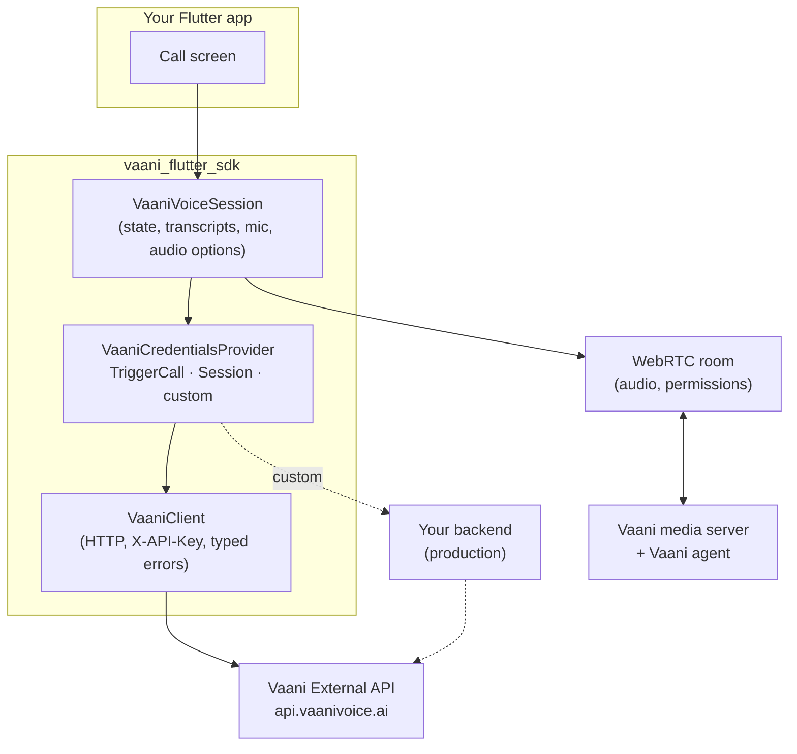
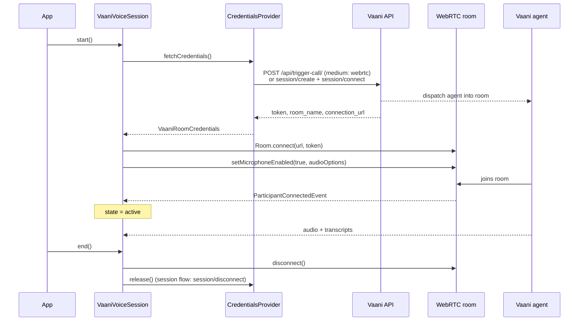
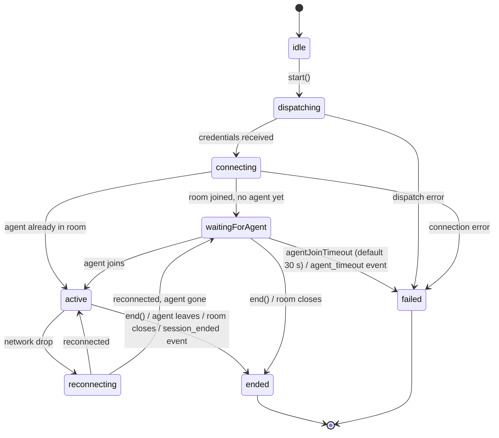

# Architecture

The SDK has three layers. Each one depends only on the layers below it, and you can use any layer directly.

| Layer | Type | Job |
|---|---|---|
| HTTP | `VaaniClient`, `client.sessions` | Calls the Vaani External API. Maps HTTP status codes to `VaaniException` subclasses. A Dart port of the Python `vaani-sdk`. |
| Dispatch | `VaaniCredentialsProvider` | Gets a Vaani agent into a WebRTC room and returns `VaaniRoomCredentials` (server URL, participant token, room name). `release()` cleans up afterwards. |
| Session | `VaaniVoiceSession` | Joins that room over WebRTC, publishes the mic, tracks the agent, and exposes state, transcripts and speaking indicators. |

There's no native code. Everything platform-specific (audio sessions, permissions, echo cancellation, WebRTC) comes from the WebRTC dependency, which is why one Dart package covers iOS and Android.

## Call lifecycle

## State machine

A session is **single-use**. Calling `start()` twice throws `StateError`, so create a new `VaaniVoiceSession` for each call.

## Design decisions

- **Dispatch is pluggable.** The API key can't be kept secret in a mobile app, so the session never needs one. It only needs something that returns room credentials. The two API-key providers are conveniences for development.
- **Wire formats mirror the Python SDK.** Endpoints, JSON field names and error semantics match `vaani-sdk` (currently 0.3.3), so backend and mobile teams share one vocabulary. See the [mapping table](python-sdk-mapping.md).
- **Audio processing is explicit.** Echo cancellation and noise suppression come from `VaaniAudioOptions`, not the WebRTC library's defaults, so a dependency upgrade can't change call quality silently.
- **Agent detection has a fallback.** The agent is the participant whose kind is `ParticipantKind.AGENT`. If no participant has that kind, the first remote participant counts, since each room is created for one agent.
- **One transcript source per speaker.** Agents can publish each transcript twice, over two different channels, with unrelated segment IDs. The session locks each speaker to whichever arrives first. Without this, every line appeared twice in live tests against Vaani.
- **The raw `Room` stays reachable.** `session.room` exposes the underlying WebRTC room for anything the wrapper doesn't cover: RPC, data messages, custom tracks.
