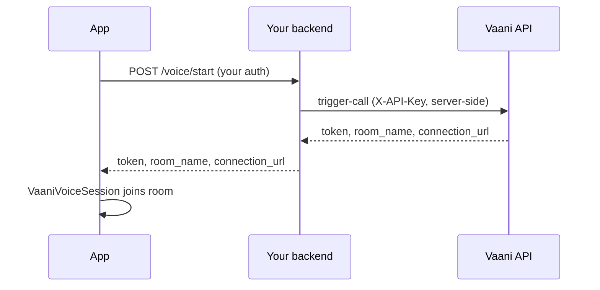

# Dispatch and credentials

"Dispatch" means asking Vaani to send an agent into a WebRTC room and getting back credentials to join it. Every path in the SDK ends in the same value:

```dart
class VaaniRoomCredentials {
  final String serverUrl;        // wss://server.vaanivoice.ai
  final String participantToken; // participant JWT
  final String roomName;         // webrtc-1794481532-5effcd48
  final String? sessionToken;    // session flow only
  final String? liveCaptionsUrl;
  final String? agentName;
}
```

A `VaaniCredentialsProvider` produces it. Pick one of three.

## Option 1: `trigger-call` (default)

`POST /api/trigger-call/` with `medium: "webrtc"`. One request dispatches the agent and returns the token.

```dart
VaaniVoiceSession.withApiKey(
  apiKey: key,
  agentId: agentId,
  dispatchOptions: const WebRtcDispatchOptions(
    primaryLanguage: 'en',          // server default: hi
    secondaryLanguage: 'hi',        // server default: en
    voiceGender: VaaniVoiceGender.female,
    welcomeMessage: 'Hi! How can I help?',
    welcomeInterruptible: true,
    voiceSpeed: 1.1,                // 0.6–1.4
    bgNoiseEnabled: false,
    metadata: {'user_id': 'u_123'}, // template variables for the agent prompt
    modifyAgent: ModifyAgentConfig(
      persona: {'identity': {'system_prompt': 'Keep answers under two sentences.'}},
    ),
  ),
);
```

Use it when you want per-call voice, language or prompt overrides.

## Option 2: the session flow

`session/create` → `session/connect`, then `session/disconnect` on end.

```dart
VaaniVoiceSession.withApiKey(
  apiKey: key,
  agentId: agentId,
  useSessionFlow: true,
  gracePeriod: const Duration(minutes: 1),   // reconnect window, 0–3600 s
  sessionTtl: const Duration(minutes: 30),   // lifetime, 60–86400 s
  initialMessage: 'User opened the support tab',
  sessionMetadata: {'user_id': 'u_123'},
);
```

You also get:
- **Session events:** `session.sessionEvents` streams `agent_ready`, `agent_timeout` and `session_ended` from the session WebSocket. The SDK ends the call on `session_ended` and fails it on `agent_timeout`.
- **A grace period:** `session.end(explicitEnd: false)` leaves the Vaani session resumable for `gracePeriod`. The default, `explicitEnd: true`, ends it immediately.

`withApiKey` always creates sessions with `ui_type: "fullpage"`. For `widget`, build the provider yourself:

```dart
final client = VaaniClient(apiKey: key);
final session = VaaniVoiceSession(
  credentialsProvider: SessionCredentialsProvider(
    client: client,
    agentId: agentId,
    uiType: VaaniUiType.widget,
    gracePeriod: const Duration(minutes: 1),
  ),
);
// You own this client: call client.close() after session.dispose().
```

Use it when you need reconnection or server-side lifecycle events.

| | `trigger-call` | Session flow |
|---|---|---|
| Requests to start | 1 | 2 |
| Voice, language, prompt overrides | ✓ | — |
| Reconnect grace period | — | ✓ |
| `agent_ready` / `session_ended` events | — | ✓ |
| Cleanup on `end()` | Leave room | Leave room + `session/disconnect` |

## Production: dispatch from your backend

**Don't ship the Vaani API key in your app.** Anything in an iOS or Android binary can be extracted. Have your backend dispatch the agent and return only the room credentials:



### Backend (Python, using the official `vaani-sdk`)

```python
# pip install vaani-sdk fastapi
import os
from fastapi import FastAPI, Depends
from vaani_sdk import AsyncVaaniClient

app = FastAPI()
vaani = AsyncVaaniClient(api_key=os.environ["VAANI_API_KEY"])

@app.post("/voice/start")
async def start_voice(user=Depends(current_user)):   # your auth
    r = await vaani.trigger_call(
        agent_id=os.environ["VAANI_AGENT_ID"],
        medium="webrtc",
        primary_language="en",
        metadata={"user_id": user.id},
    )
    return {"connection_url": r.connection_url, "token": r.token, "room_name": r.room_name}
```

### App

```dart
final session = VaaniVoiceSession(
  credentialsProvider: VaaniCredentialsProvider.custom(() async {
    final res = await myApi.post('/voice/start');
    return VaaniRoomCredentials(
      serverUrl: res['connection_url'],
      participantToken: res['token'],
      roomName: res['room_name'],
    );
  }),
);
```

If your backend uses the session flow and should end the session when the call ends, subclass `VaaniCredentialsProvider` and override `release()`:

```dart
class MyBackendProvider extends VaaniCredentialsProvider {
  @override
  Future<VaaniRoomCredentials> fetchCredentials() async { /* POST /voice/start */ }

  @override
  Future<void> release(VaaniRoomCredentials c, {required bool explicitEnd}) =>
      myApi.post('/voice/end', {'room': c.roomName, 'explicit_end': explicitEnd});
}
```

`release()` always runs when a session ends, whether through `end()`, a failure, the agent leaving, or `dispose()`. Errors it throws are swallowed, because the backend expires sessions on its own anyway.

## Using `VaaniClient` directly

No session, just HTTP:

```dart
final client = VaaniClient(apiKey: key);   // baseUrl, timeout (default 30 s), httpClient
final creds = await client.dispatchWebRtc(agentId: id);            // VaaniRoomCredentials
final raw   = await client.triggerWebRtcCall(agentId: id);         // TriggerCallResponse
final s     = await client.sessions.createAndConnect(agentId: id); // session flow
client.close();
```

`client.request(method, path, body:, query:)` reaches any endpoint the SDK doesn't wrap, with auth and error mapping included.

## Outbound phone calls

The same endpoint places telephony calls. This usually belongs on a backend, but it's available:

```dart
final r = await client.triggerTelephonyCall(
  agentId: id,
  options: const TelephonyCallOptions(
    contactNumber: '+919876543210',
    name: 'Rahul',
    bypassTrai: true,        // allow after 8 PM IST; needs workspace permission
    dndCheckSkipped: false,
  ),
);
print(r.callId);      // outbound-1776774443-863aa698
print(r.dispatchId);  // dispatch-outbound-...
```
